# Procesos

## `ps`
Muestra información de los procesos activos.

### `ps a`
Muestra los procesos asociados a una terminal (`TTY`) de todos los usuarios, indicando PID, terminal, estado, tiempo de CPU y comando.

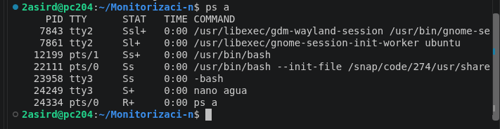

### `ps au`
Muestra los procesos asociados a una terminal en formato orientado al usuario, añadiendo columnas como `USER`, `%CPU`, `%MEM`, `VSZ`, `RSS` y hora de inicio (`START`).

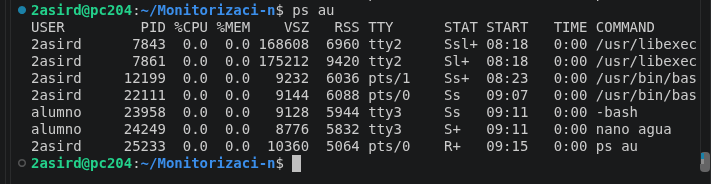

### `ps aux`
Muestra todos los procesos activos del sistema, incluidos los procesos en segundo plano o demonios que no tienen una terminal asociada (`TTY` = `?`).

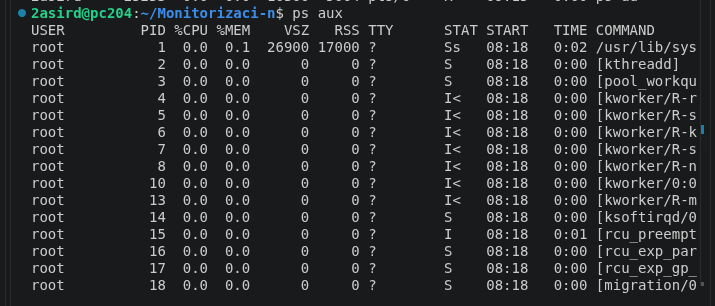

### `ps u -C`, `ps -u` y `ps -C`
En esta captura se utilizan tres variantes para filtrar procesos específicos:
- `ps u -C nano`: muestra en formato detallado (`u`) los procesos cuyo nombre de comando es `nano` (`-C nano`).
- `ps -u alumno`: muestra todos los procesos pertenecientes al usuario `alumno`.
- `ps -C nano`: muestra de forma resumida los procesos cuyo comando es `nano`.

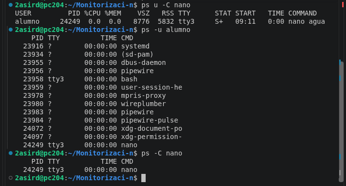

---

## `top`
Monitor interactivo en tiempo real de los procesos y el rendimiento del sistema (CPU, memoria, swap y tareas).
- `M`: Ordena por memoria.
- `P`: Ordena por CPU.
- `T`: Ordena por tiempo de uso.
- `N`: Ordena el PID de mayor a menor y al usar la `R` ordena de menor a mayor.

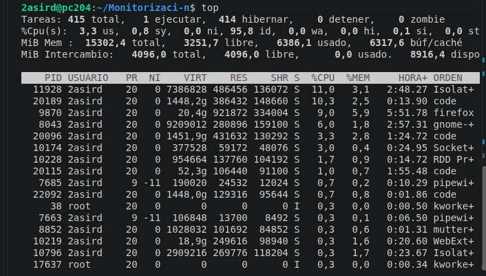

---

## `htop`
Visor interactivo de procesos más visual que `top`, que muestra barras de uso por cada núcleo de CPU, memoria y swap, además de permitir ordenar, filtrar y gestionar procesos con teclas de función.

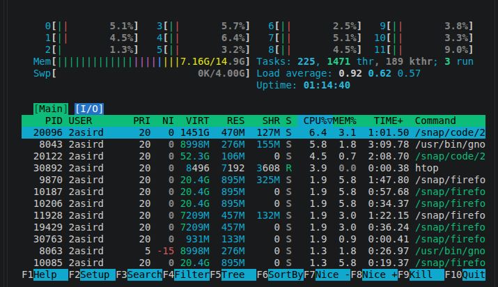

### Prueba de carga en `htop` (`yes`)
Ejemplo de `htop` monitorizando un pico de consumo de CPU generado con el comando `yes`, donde varios núcleos alcanzan el 100% y los procesos `yes` aparecen en lo más alto de la tabla.

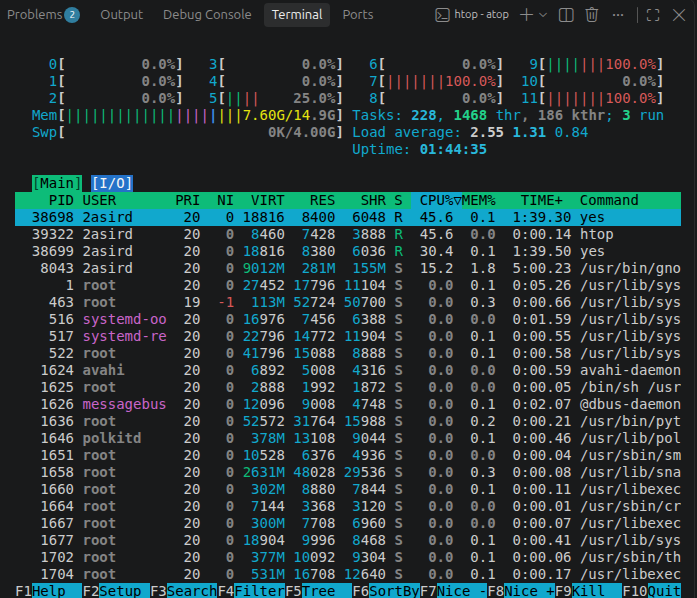

---

## Ejercicio
- Utilizando el comando `top` necesitamos mandar a nuestro jefe de proyecto una lista de los 10 procesos que consumen más CPU durante tres periodos consecutivos.

### `top -b -n 3 > top.info`
Ejecuta `top` en modo por lotes (`-b`, sin interfaz interactiva) durante 3 iteraciones (`-n 3`) y redirige la salida al archivo `top.info`.

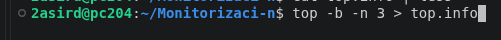

### `cat top.info | less`
Muestra el contenido del archivo `top.info` paginado con `less` para revisar la información capturada en los distintos periodos.

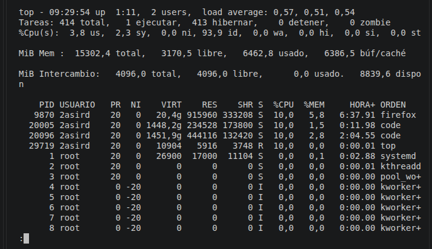

### `cat reporte_cpu.txt`
Muestra el archivo `reporte_cpu.txt` con el listado filtrado de los 10 procesos con mayor consumo de CPU en periodos consecutivos.

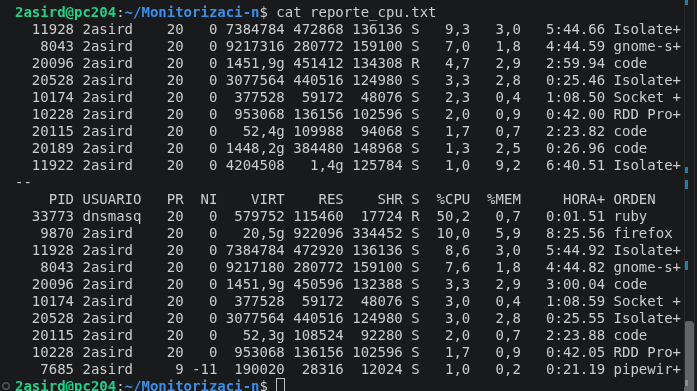

---

## `atop`
Monitor avanzado del rendimiento del sistema y procesos en tiempo real e histórico (CPU por núcleo, memoria, swap, paginación, discos y tráfico de red).
- `t`: muestra cada registro y su fecha.

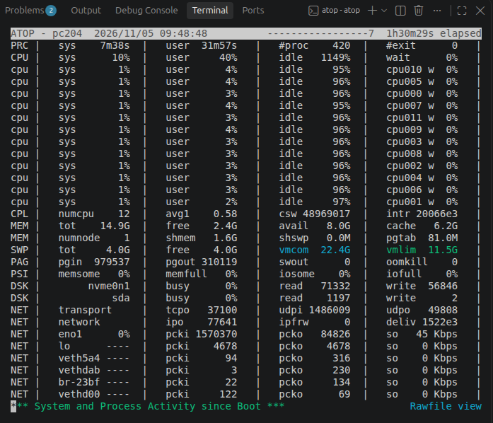
