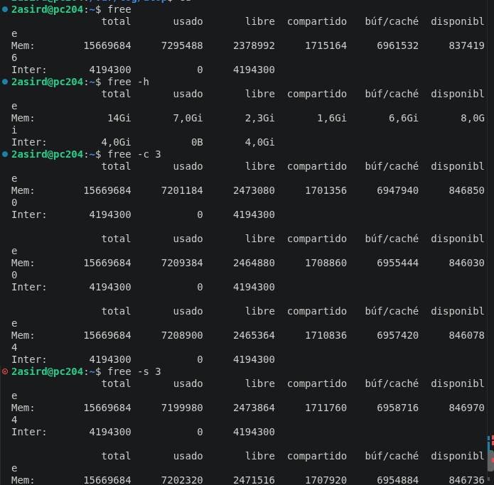
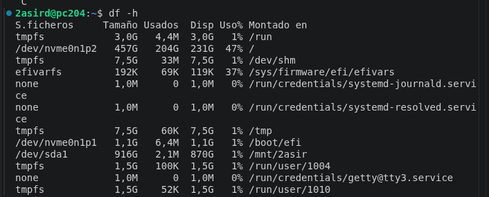
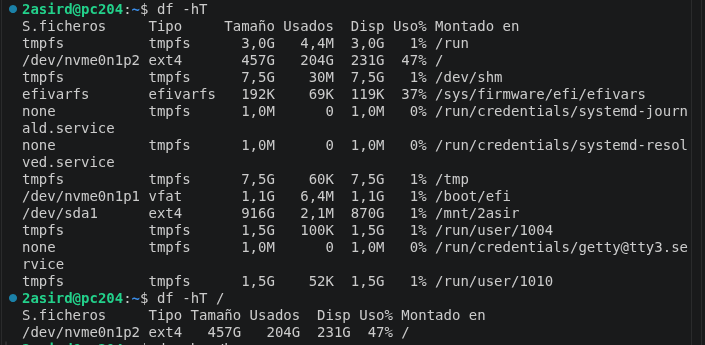
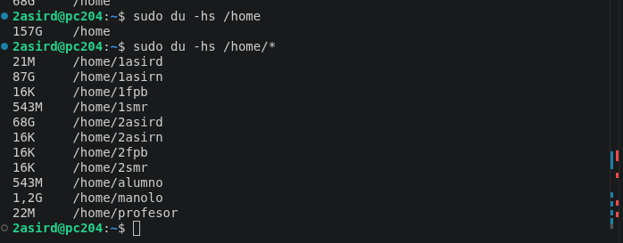
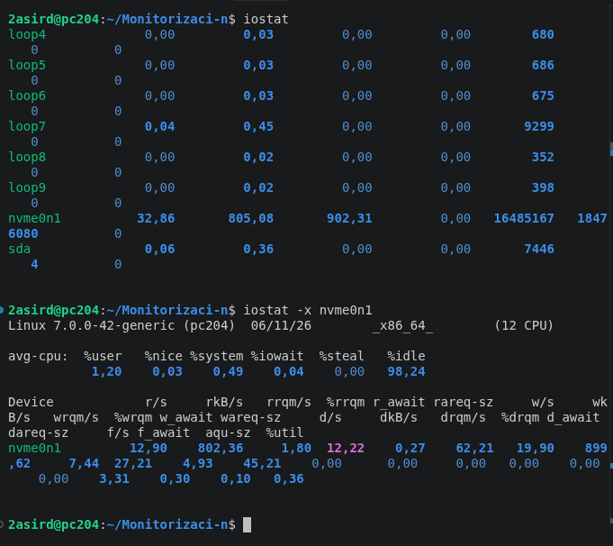
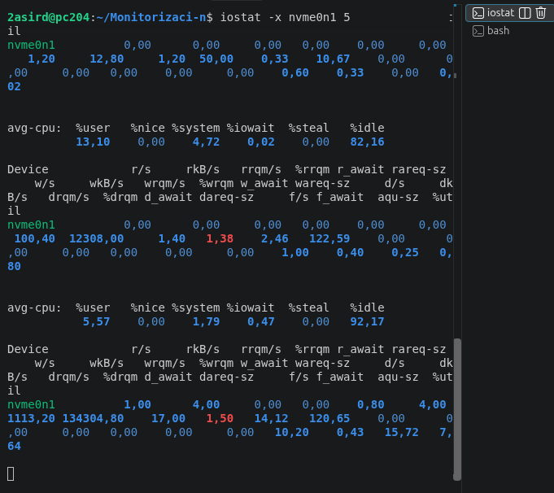
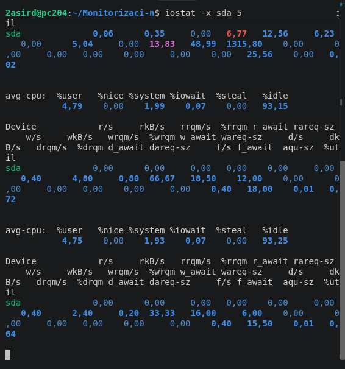

# Memoria y rendimiento del disco

## `free`
Muestra la cantidad de memoria RAM y de intercambio (`swap`) libre y utilizada en el sistema.

En esta captura se utilizan cuatro variantes:
- `free`: muestra la memoria en kibibytes (KiB).
- `free -h`: muestra los valores en formato legible para humanos (`Gi`, `Mi`, etc.).
- `free -c 3`: muestra la información repetida 3 veces.
- `free -s 3`: actualiza y muestra la información continuamente cada 3 segundos.

---

## `df`
Muestra el espacio utilizado y disponible en los sistemas de archivos montados.

### `df -h`
Muestra el espacio en disco en formato legible para humanos (`G`, `M`, `K`).

### `df -hT` y `df -hT /`
- `df -hT`: además del formato legible (`-h`), añade la columna `Tipo` indicando el sistema de archivos (`ext4`, `tmpfs`, `vfat`, etc.).
- `df -hT /`: muestra la misma información filtrada únicamente para la partición raíz (`/`).

---

## `du`
Calcula el espacio ocupado en disco por directorios y archivos.

En esta captura se utilizan:
- `sudo du -hs /home`: muestra el tamaño total resumido (`-s`) en formato legible (`-h`) del directorio `/home`.
- `sudo du -hs /home/*`: muestra el tamaño resumido de cada carpeta de usuario dentro de `/home`.

---

## `iostat`
Se utiliza para detectar problemas de rendimiento en los dispositivos de almacenamiento mostrando estadísticas de CPU y de entrada/salida (E/S) de disco.

### `iostat` y `iostat -x nvme0n1`
- `iostat`: muestra un resumen básico de lectura/escritura de todos los dispositivos de bloques.
- `iostat -x nvme0n1`: muestra estadísticas extendidas (`-x`, como tiempos de espera `await`, tamaño medio de petición y `%util`) específicamente para el disco `nvme0n1`.

### `iostat -x nvme0n1 5`
Muestra estadísticas extendidas del disco `nvme0n1` actualizándose automáticamente cada 5 segundos.

### `iostat -x sda 5`
Muestra estadísticas extendidas del disco `sda` actualizándose automáticamente cada 5 segundos.

