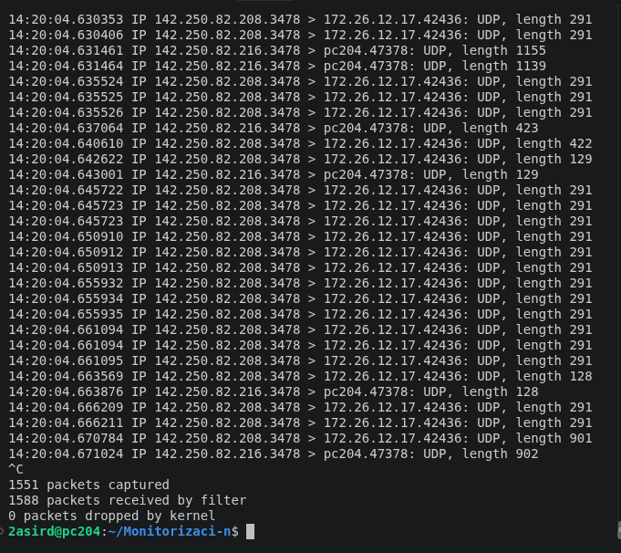
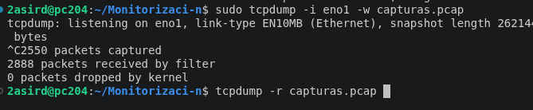
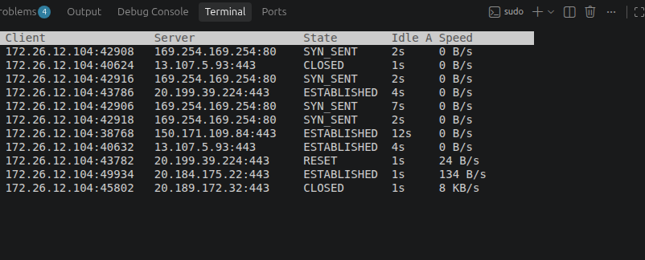
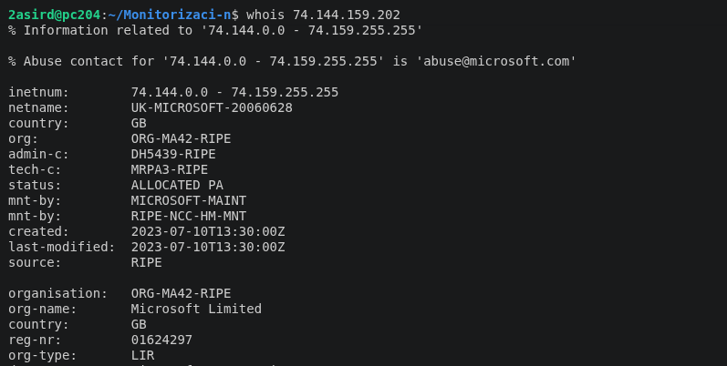
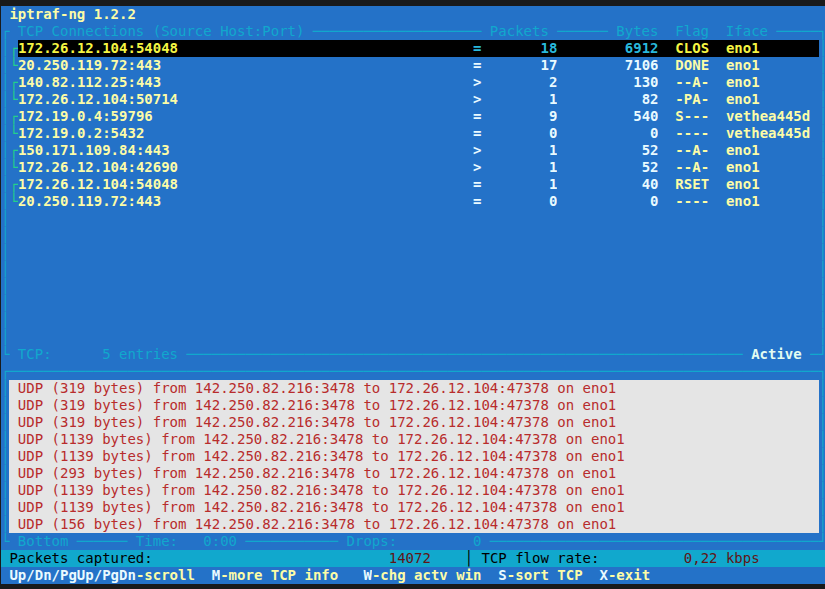
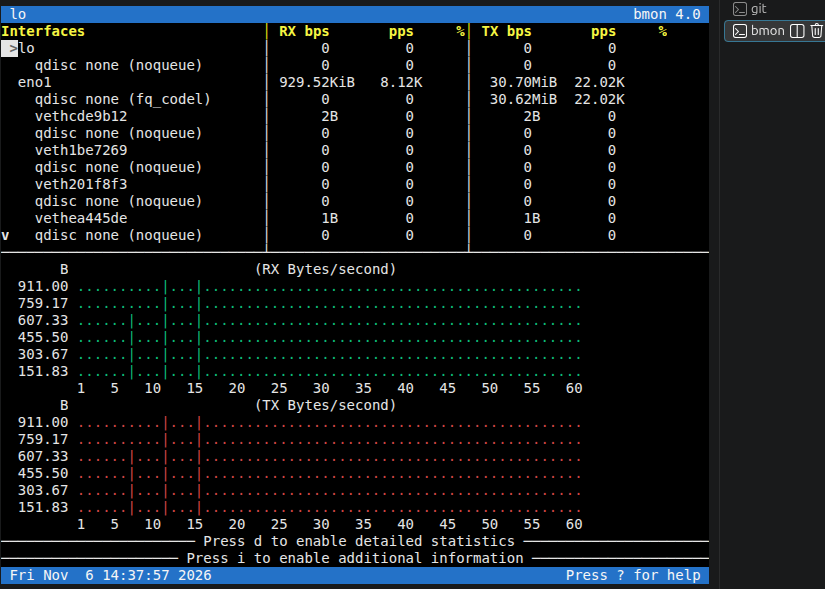
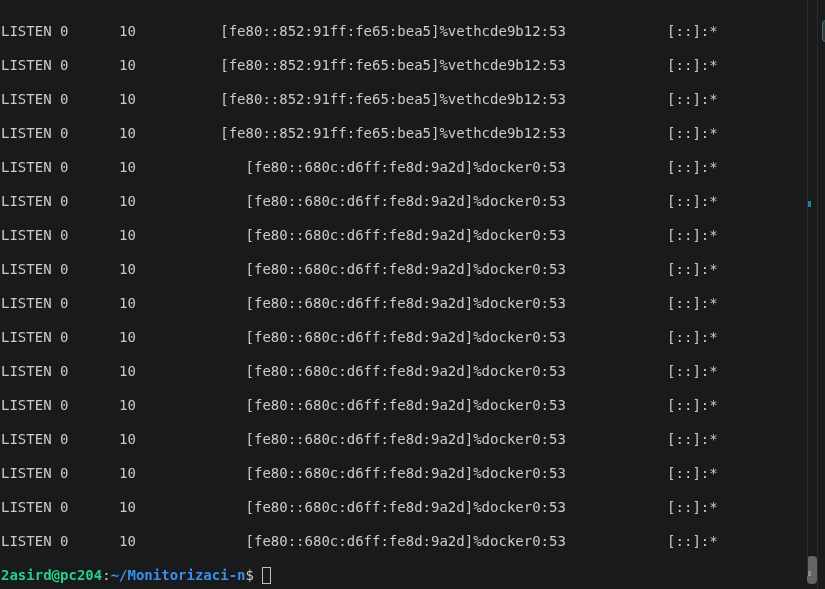

# Tráfico de la Red

## `tcpdump`
Analizador de paquetes en línea de comandos que permite capturar y mostrar el tráfico que circula por las interfaces de red.

### Captura en tiempo real (`sudo tcpdump`)
Muestra en tiempo real los paquetes capturados en la interfaz de red (en la imagen, paquetes UDP con sus direcciones IP de origen/destino, puertos y longitud) y al detenerlo con `Ctrl+C` indica el total de paquetes capturados.

### Guardar y leer capturas (`tcpdump -w` y `tcpdump -r`)
- `sudo tcpdump -i eno1 -w capturas.pcap`: escucha en la interfaz `eno1` (`-i eno1`) y guarda los paquetes capturados en el archivo `capturas.pcap` (`-w`).
- `tcpdump -r capturas.pcap`: lee y muestra los paquetes almacenados previamente en `capturas.pcap` (`-r`).

---

## `tcptrack`
Herramienta interactiva (`sudo tcptrack -i eno1`) que monitoriza en tiempo real las conexiones TCP activas, mostrando el cliente, el servidor, el estado de la conexión (`SYN_SENT`, `ESTABLISHED`, `CLOSED`, `RESET`), el tiempo de inactividad (`Idle`) y la velocidad de transferencia (`Speed`).

---

## `whois`
Comando `whois 74.144.159.202` utilizado para consultar información pública de registro sobre una dirección IP o dominio, mostrando el rango de red (`inetnum`), nombre de la red, país, organización propietaria y contactos de administración.

---

## `iptraf-ng`
Monitor interactivo de tráfico de red en terminal (`sudo iptraf-ng`) que muestra en tiempo real las conexiones TCP activas (paquetes, bytes, flags e interfaz) en la parte superior y el tráfico UDP u otros paquetes en la parte inferior.

---

## `bmon`
Monitor de ancho de banda en tiempo real (`bmon`) por interfaz de red (`lo`, `eno1`, interfaces `veth`, etc.), mostrando las tasas de recepción (`RX bps`, `pps`) y transmisión (`TX bps`, `pps`) junto con gráficos de evolución por segundo.

---

## `ss`
Utilidad (`ss`, por ejemplo `ss -l` o `ss -tuln`) para inspeccionar los sockets de red del sistema. En la captura se observan sockets en estado `LISTEN` escuchando en el puerto `53` (DNS) sobre interfaces IPv6 (`veth...` y `docker0`).

