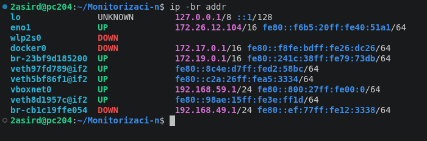
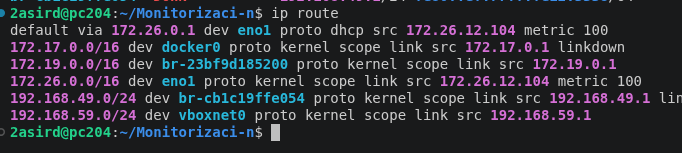
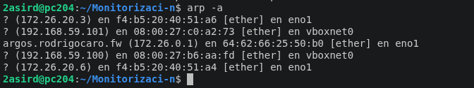
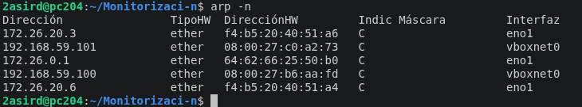
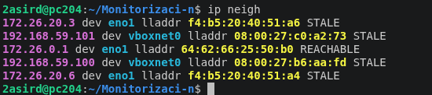
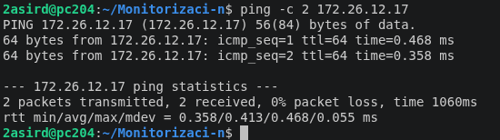
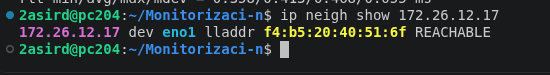
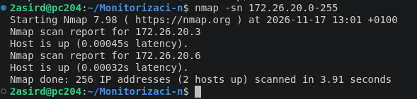
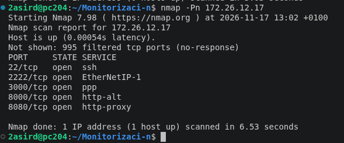
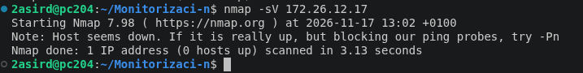

# Análisis de la red con `arp` y `nmap`

**Unidad:** U3.- Monitorización  
**Sesión/práctica:** Análisis de red local

---

## 1.- Identificar la configuración de red

### 1.- Indica la IP y la interfaz de red de tu equipo
- **Interfaz de red principal:** `eno1`
- **Dirección IP:** `172.26.12.104`



### 2.- Anota la puerta de enlace predeterminada
- **Puerta de enlace predeterminada:** `172.26.0.1` (a través de `eno1`)

### 3.- Indica la dirección de red y su prefijo o máscara
- **Dirección de red:** `172.26.0.0`
- **Prefijo:** `/16`
- **Máscara de red:** `255.255.0.0`



---

## 2.- Analizar y renovar una entrada ARP

### 1.- IP del ordenador del profesor y comprobación de red local IPv4
- **IP del profesor:** `172.26.12.17`
- **Comprobación:** Como nuestra red es `172.26.0.0/16` (máscara `255.255.0.0`), la IP `172.26.12.17` pertenece a la misma red local IPv4 que nuestro equipo (`172.26.12.104/16`).

### 2.- Ejecuta los siguientes comandos e indica qué hace cada uno

#### `arp -a`
Muestra la tabla ARP actual del sistema en formato BSD, intentando resolver los nombres de host (DNS inverso) junto a su dirección IP, dirección MAC y la interfaz asociada. En la captura aparecen la puerta de enlace (`argos.rodrigocaro.fw` / `172.26.0.1`), dos equipos de la red local (`172.26.20.3` y `172.26.20.6` en `eno1`) y dos de `vboxnet0` (`192.168.59.100` y `192.168.59.101`).



#### `arp -n`
Muestra la misma tabla ARP pero en formato numérico (`-n`), es decir, **sin resolver nombres de host**, lo que acelera la consulta y muestra directamente las direcciones IP (`172.26.0.1`, `172.26.20.3`, `172.26.20.6`, `192.168.59.100` y `192.168.59.101`).



#### `ip neigh`
Comando moderno de la suite `iproute2` que muestra la tabla de vecinos (caché ARP en IPv4 y NDP en IPv6), indicando la IP, la interfaz (`dev`), la dirección MAC (`lladdr`) y el estado de cada entrada (`REACHABLE` para `172.26.0.1` y `STALE` para las demás).



### 3.- ¿Qué MAC aparece asociada a la puerta de enlace? ¿Por qué la tabla ARP no muestra todos los equipos de la red?
- **MAC asociada a la puerta de enlace (`172.26.0.1`):** `64:62:66:25:50:b0` (en la interfaz `eno1`).
- **¿Por qué no muestra todos los equipos de la red?**  
  Porque la tabla ARP funciona como una **caché dinámica**: el sistema operativo solo aprende y guarda las asociaciones IP-MAC de los equipos con los que se ha comunicado recientemente. Si no ha habido tráfico previo con otros equipos de la red, no aparecen en la tabla (y además las entradas caducan pasado un tiempo si no se utilizan).

### 4.- Genera y consulta la entrada del profesor
Ejecutamos `ping` a la IP del profesor (`172.26.12.17`):
```bash
ping -c 2 172.26.12.17
```
Se transmiten 2 paquetes y se reciben 2 (`0% packet loss`).



Consultamos su entrada en la tabla de vecinos:
```bash
ip neigh show 172.26.12.17
```
Aparece la entrada `172.26.12.17 dev eno1 lladdr f4:b5:20:40:51:6f REACHABLE`.



### 5.- Elimina únicamente esa asociación en tu ordenador
```bash
sudo ip neigh del 172.26.12.17 dev eno1
ip neigh show 172.26.12.17
```
*(Nota: `ip neigh del` requiere privilegios de superusuario con `sudo`).*  
Al ejecutar `ip neigh show 172.26.12.17` inmediatamente después, la entrada desaparece (o pasa a `FAILED`) hasta que vuelva a producirse tráfico.

### 6.- Si no se genera automáticamente, puedes hacerlo:
```bash
ping -c 2 172.26.12.17
ip neigh show 172.26.12.17
```
Al volver a hacer `ping`, el sistema lanza de nuevo una petición ARP y regenera la entrada en la tabla de vecinos con la MAC `f4:b5:20:40:51:6f` en estado `REACHABLE`.

---

## 3.- Descubrir equipos con Nmap

### 1.- Escanea desde la `172.26.20.0` hasta `172.26.20.255` con `nmap -sn`
```bash
nmap -sn 172.26.20.0-255
```
Se escanearon 256 direcciones IP en 3.91 segundos y se detectaron **2 equipos activos**:
- `172.26.20.3` (`0.00045s latency`)
- `172.26.20.6` (`0.00032s latency`)



### 2.- ¿Qué hace exactamente la opción `-sn`?
La opción **`-sn`** (*Ping Scan* / descubrimiento de hosts sin escaneo de puertos) indica a `nmap` que **únicamente compruebe qué equipos están activos** en la red o rango indicado, **sin realizar ningún escaneo de puertos** sobre ellos.

---

## 4.- Examinar puertos y servicios

### 1.- Escanea exclusivamente la máquina objetivo indicada por el profesor (`172.26.12.17`)

#### Escaneo de puertos (`nmap -Pn 172.26.12.17`)
Al escanear la IP `172.26.12.17` con `-Pn` (para omitir el descubrimiento previo de host si bloquea las sondas de Nmap), se detectan **5 puertos TCP abiertos** (y 995 filtrados sin respuesta):
- `22/tcp` — `ssh`
- `2222/tcp` — `EtherNetIP-1`
- `3000/tcp` — `ppp`
- `8000/tcp` — `http-alt`
- `8080/tcp` — `http-proxy`



#### Escaneo de versiones (`nmap -sV 172.26.12.17`)
Al ejecutar `nmap -sV 172.26.12.17` sin `-Pn`, Nmap indica:
`Note: Host seems down. If it is really up, but blocking our ping probes, try -Pn` (`0 hosts up`), ya que la máquina objetivo bloquea las sondas de descubrimiento de Nmap (por eso es necesario añadir `-Pn`, es decir, `nmap -sV -Pn 172.26.12.17`, para que escanee los puertos y detecte las versiones).



#### ¿Qué hace la opción `-sV`?
La opción **`-sV`** (*Service/Version detection*) activa la **detección de versiones**: `nmap` se conecta a los puertos abiertos encontrados, envía sondas específicas y analiza las respuestas o *banners* para averiguar qué aplicación y versión concreta está ejecutando ese servicio.
